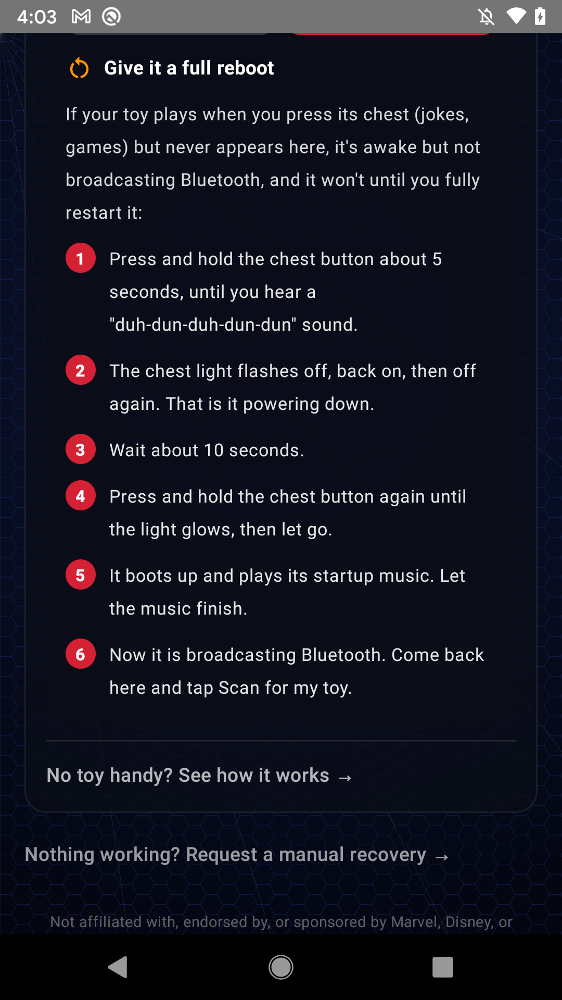
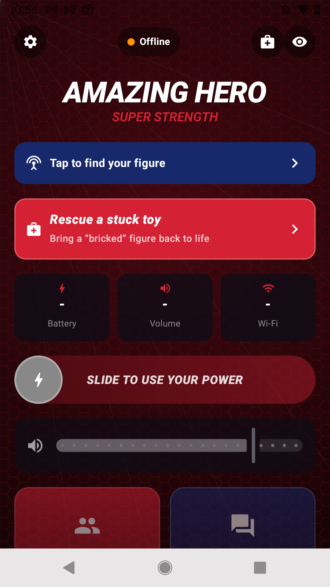
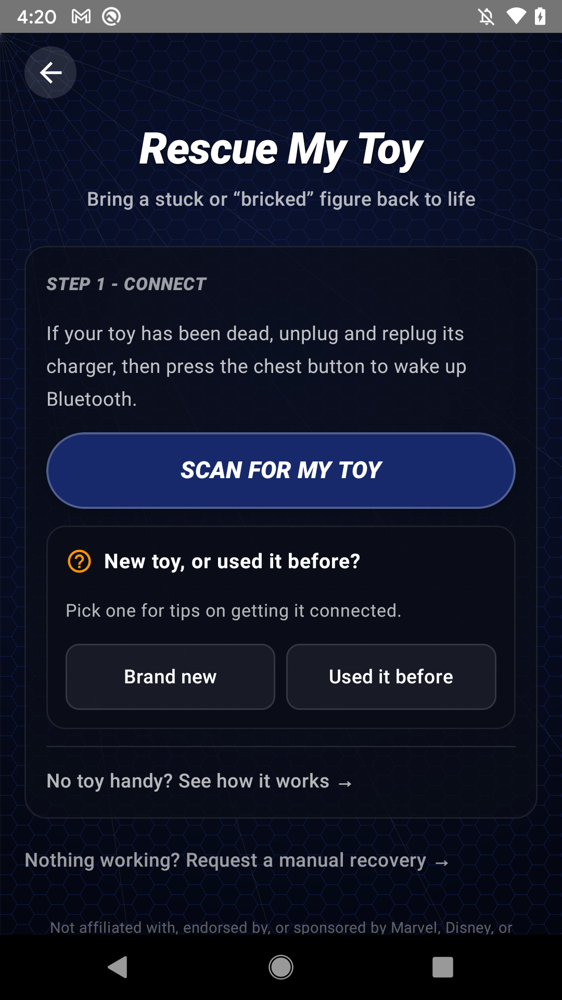
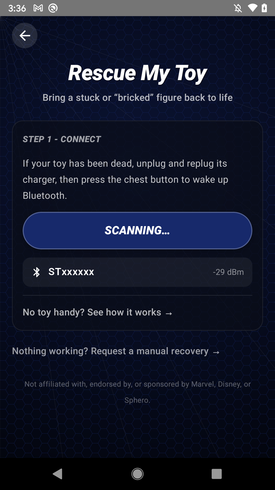
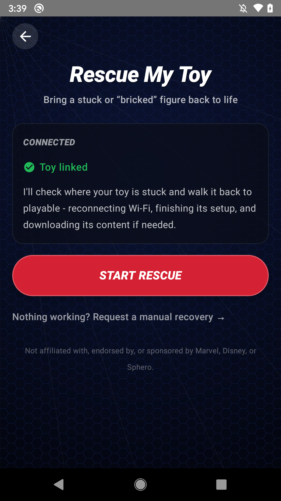
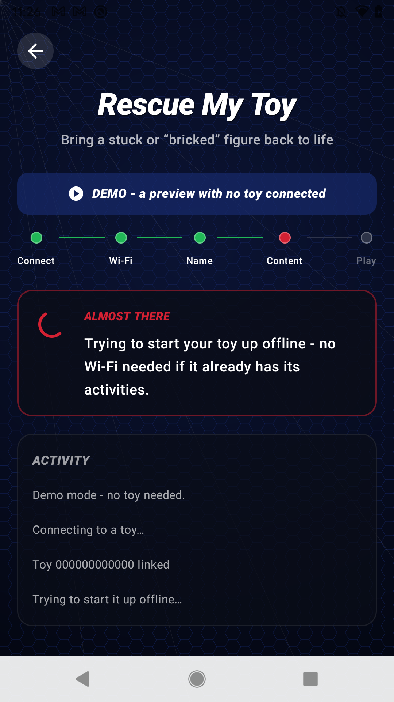
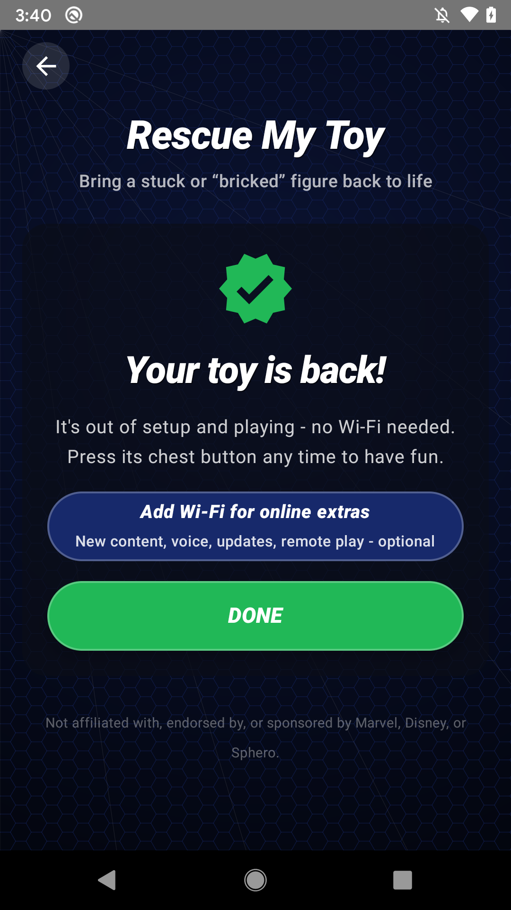
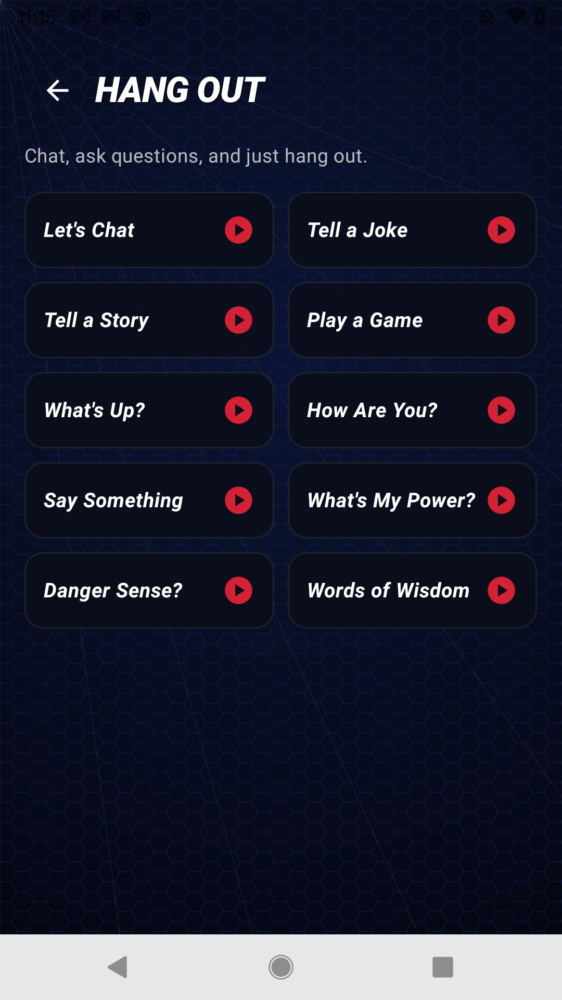

# Getting started

Welcome. This page gets the free app onto your phone and connects it to your Spider-Man toy. It takes about five minutes, and most of that is just waiting for the toy's startup music. We walk you through every tap.

*Not affiliated with, endorsed by, or sponsored by Marvel, Disney, or Sphero. This is a fan-made project to bring a discontinued toy back to life.*

## What you need

- The **Sphero Spider-Man interactive toy** (the 2017 talking figure), charged and turned on.
- A phone or tablet with **Bluetooth** (that is the short-range wireless your phone uses for headphones and such):
  - **iPhone or iPad** on **iOS 16 or later**, or
  - An **Android phone** on **Android 8.0 or later**.
- For a completely blank toy only, your home **Wi-Fi name and password**. Most toys never need this. (See the [recovery matrix](recovery-matrix.md) for which ones do.)

You do **not** need an account, a sign-in, or to give us any personal information. There is no sign-in at all.

## Which kind of toy do you have?

There are two kinds, and they behave a little differently. To tell which one you have, **press the toy's chest button** and watch:

- **If it plays a joke, tells a story, or starts a game, you used it before.** It still has everything on board. The catch: when you just turn it on, it does not call out over Bluetooth, so your phone cannot spot it yet. You will fix that with a quick full reboot (steps below).
- **If it only blinks and waits, it was never set up.** After a full power-off and on it calls out over Bluetooth on its own, starting 1 to 4 minutes after the startup music, so keep scanning.

One word you will see a lot: **broadcasting.** For your phone to find the toy, the toy has to be *broadcasting* over Bluetooth, which just means calling out, like waving so the phone can spot it in a crowd. A used toy only does this for about 30 seconds after you turn it on (a toy that was never set up starts 1 to 4 minutes after power-on and keeps going), then it goes quiet again. If a scan finds nothing, that quiet window is usually why, and you power it fully off and on again; a chest press wakes it to talk but does not make it call out.

## Get the app

### iPhone or iPad (TestFlight)

The iPhone version is an open public beta through Apple's official beta app, TestFlight. Anyone with the link can join.

1. **Install TestFlight** from the App Store, if you do not have it already.
2. **Open the beta link** on your iPhone or iPad: [testflight.apple.com/join/GkAkHu1y](https://testflight.apple.com/join/GkAkHu1y).
3. **Tap Accept,** then **Install** to put Second Life Toys on your device. It works on iOS 16 or later.
4. TestFlight tells you when a newer version is ready. If you already have the app, open TestFlight and tap **Update**. If the app ever stops opening after a few months, that just means the beta expired, so check TestFlight for an update.

TestFlight is Apple's own beta system, so this is a normal, safe way to install. An App Store release is in progress; TestFlight is the way in today.

### Android (install the app)

Second Life Toys for Android is in a Google Play test right now, so it takes two quick steps before you install it from the Play Store.

1. **Join the testers group:** [groups.google.com/g/spidey-testers](https://groups.google.com/g/spidey-testers).
2. **Opt in to the test:** [play.google.com/apps/testing/com.secondlifetoys.app](https://play.google.com/apps/testing/com.secondlifetoys.app).
3. **Give it a few minutes, then install** (or update) Second Life Toys from the Play Store.

Use the same Google account on your phone that you used to join the group. It works on Android 8.0 or later. Opting in really helps: Google wants real testers on the app for about two weeks before it can become a normal public listing.

Skip the old APK on the GitHub releases page: it is an older build that is missing fixes. If you already installed it, uninstall it first, then install from the Play Store.

## Revive your toy

This is the main event, one screen at a time. Follow it top to bottom.

**1. Turn your phone's Bluetooth ON.** You should see the Bluetooth icon in your status bar. A phone with Bluetooth off is the number-one reason a scan finds nothing, and it fails silently with no error, so double-check this one.

**2. Keep the toy right next to the phone.** Bluetooth only reaches a short distance, so set the toy down beside the phone, not across the room.

**3. Used your toy before? Reboot it first.** (Skip this if your toy only blinks and waits, it is already broadcasting.) A used toy will not show up until you give it a fresh broadcasting window with a full reboot:

  1. Press and hold the chest button about 5 seconds, until you hear a "duh-dun-duh-dun-dun" sound.
  2. The chest light flashes off, back on, then off again. That is it powering down.
  3. Wait about 10 seconds.
  4. Press and hold the chest button again until the light glows, then let go.
  5. It boots up and plays its startup music. Let the music finish.
  6. Now it is broadcasting. Move to the next step right away, the window is short.

**4. Open the app and tap "Rescue a stuck toy."** The app opens to a dashboard. Tap the red **Rescue a stuck toy** button.

**5. Tap "Scan for my toy."** The button changes to "Scanning..." while it looks for your toy.

**6. Your toy appears. Tap it.** It shows up as a name that starts with **`ST`** (for example `ST1e9fda`). Tap that name to connect.

**7. It says "Toy linked." Tap START RESCUE.** A green check and "Toy linked" mean you are connected. Tap the red **START RESCUE** button.

**8. Let the app do its thing.** It figures out what is wrong and fixes what it can on its own. It only stops to ask you for something if the toy truly needs it. **Only a completely blank toy needs Wi-Fi,** and only once, to download its content. If it does ask, type your home Wi-Fi name and password (or a hero name), which is normal and one-time. Most toys revive over Bluetooth with no Wi-Fi at all.

**9. "Your toy is back!"** When the app says you are done, press the toy's chest button. It plays a joke or starts a game, just like before.

If the toy never showed up in step 6, do not worry, it is almost always one small thing. See [Troubleshooting](troubleshooting.md). The top two tips: make sure your phone's Bluetooth is truly on, and reboot a used toy to reopen its broadcasting window.

## Just want to play?

If your toy already works and you just want to control it, use the play path instead of Rescue.

1. On the dashboard, tap **Tap to find your figure.**
2. Tap **Scan for my toy,** then tap your toy (the name starting with `ST`) when it appears.
3. **The first time only,** you will see a **Wake Your Figure** screen. Press the toy's chest button, then tap **Done.**
4. Now you are on the dashboard, connected. You can start activities (Team Up, Hang Out, Fight Villains), turn on Guard Mode, set an alarm, change the eye colors, and adjust the volume. When you tap an activity, the toy plays it.

## No toy handy?

Want to see how the app works before you dig the toy out? On the Rescue screen, tap **No toy handy? See how it works.** It runs a quick preview with no toy needed, so you can look around safely.

## If it does not work

Head to [Troubleshooting](troubleshooting.md). Nearly every "it will not find my toy" moment is one of a few simple things, and the two that fix it most often are: confirm your phone's Bluetooth is genuinely on, and reboot a used toy to reopen its short broadcasting window.
